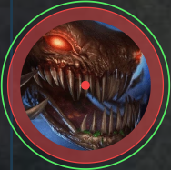

# Wave3 2.99.12 · Web 人人对战待玩家测试

本次使用冻结版本 U83/C84/R50、FAQ 1.3。500 分和 2000 分都能从 Web 大厅建房。已有 2000 分双浏览器操作记录覆盖手工写表、邀请另一席、操作到 r4 和断线重连。还从独立 Git 快照还原了 14 份冻结输入，两种规模均在真实接口返回 HTTP 201 和新房号。[独立建房记录](evidence/wave3-human-media/standalone-room-check.json)

两名玩家可以从同一服务的 /match 进入。完整 Wave3 开发为 9/16，原生 App 的 M25 等待真机。

## 棋子与声音

45 个冻结单位各有独立的官方卡图和棋子识别图，含本次新增的 19 个。虫族七种变体与基础单位逐 ID 区分。25 个游戏动态通讯头像可供播放。20 个单位匹配本单位的游戏形象，Nova 两种模式使用同一位 Nova。其余 23 项采用相近单位的通讯形象，主图保留该单位自己的桌游形象，面板标示共用。原声按选择、确认、受伤、阵亡分别映射，缺少对应录音的事件保持安静。逐单位和逐文件来源见[素材清单](../../../content/client/wave3-battlefield-media-sources-v1.json)和[运行时映射](../../../packages/client-domain/wave3-battlefield-media-v1.mjs)。

玩家点击棋子时，底盘外出现细绿线，队色仍在内侧。放大地图后，绿线仍为 1.75 个屏幕像素。两席均已加载 Defiler 头像并播放原声。浏览器解码了 115 张静态或动态图片。抽检选择、确认和阵亡三类录音，在浏览器中均可解码。结果见[双席记录](evidence/wave3-human-media/media-result.public.json)和[选中与声音记录](evidence/wave3-human-media/selection-result.public.json)。



三族各有一首可手动播放的经典曲目。当前验收机验证了三首完整音轨。新部署默认使用唱片发行方提供的试听。拥有完整音轨的房主可将对应文件放入服务数据目录的 soundtrack 子目录，文件名为 terran-one.mp3、protoss-one.mp3、zerg-one.mp3。个人也可通过战桌选择本地音乐。完整商业音轨独立于仓库。[发行方曲目页](https://macphersonrecords.com/starcraft)

## 在独立检出中启动

使用已有 Node、Expo 项目依赖。在检出目录运行以下命令。第一条会还原 14 份有哈希的运行输入，包含存放在父目录 scripts 下的共享 Rules。已有不同字节的文件会被拒绝覆盖。

```sh
node scripts/prepare-wave3-human-playtest.mjs --include-shared-rules
node scripts/verify-wave3-unit-media.mjs
node scripts/build-slice249-learning-web-v1.mjs build/wave3-human-playtest
node scripts/serve-starcraft-product-v1.mjs --offline --wave3-match-candidate=2.99.12 --web-root=build/wave3-human-playtest/web --data-directory=build/wave3-human-playtest/host --port=4174
```

在浏览器打开 http://127.0.0.1:4174/match ，选择「人人对战」。第二席使用房间面板生成的邀请。验收配置使用开发媒体渠道，公网发布须另行确认素材授权。AI 对战、付费模型与副官实答保持暂停。
