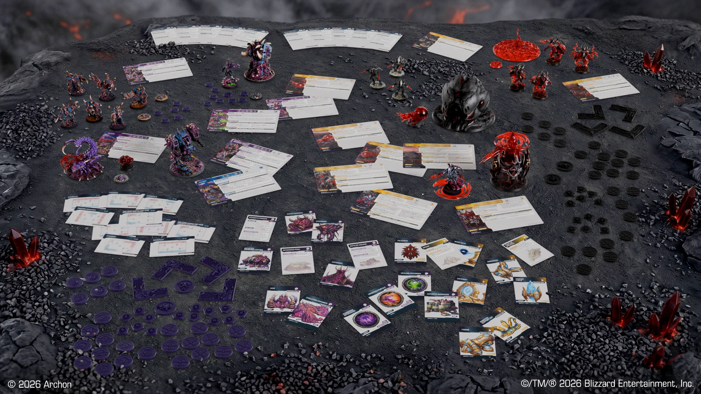

# W4-02：Hostile Incubation 与炮塔条件几何

本页保留 `d38a2c2` 首批组件验收的历史范围。Firefly 解析及另外两条反应已在后续完成显式绑定，完整原生回合与 Web 后继见[当前批次报告](turret-combat-wiring.zh-CN.md)；以下“待接”不代表当前状态。

本批新增 **1 个游戏原子，累计 3/18**：`rule-atom:wave4/spawn-round-ability-lock@1`。Hostile Incubation 已通过一条 Native 签名设置动作、幂等重交和冷重放。空间结果使用用户允许的官方截图估算：圆形 80 mm，保守误差范围 60–100 mm、低置信度。该结果只证明这份条件几何下的组件接线；整版 Wave4、炮塔完整行为、正式开局和新增数据 Web 验收仍未完成。

## 逐 ID 与实际消费者

以下 ID 的共同单位前缀为 `unit:infested_missile_turret/`；完整 ID、来源哈希和消费者文件保留在[当前接线账](../../../coordination/wave4/ability-wiring-progress.json)。本批选择 102/119 条单位／卡记录；原始能力分母仍为 556。

| ID | 能力差分类别 | 本批行为与实际消费者 | 新原子 |
| --- | --- | --- | ---: |
| `card:stukov_s_forces/hostile-incubation-any@1` | 新增语义 | `createOfficialUnitLifecycleFamilySourceBundleV2` 编译精确来源，生命周期 Adapter 用既有 SET／空间放置链设置单位，再绑定回合锁。原生房间成功 Apply、重交与冷重放。 | 1 |
| `detection-any-phase@1` | 已有原子的新组合 | 特性 Adapter 编译 8" Detection；`projectOfficialCharacteristicStatusFamilyModifiersV1` 按来源范围查询，`consumeOfficialDetectionHiddenStatusesV1` 移除 HIDDEN。本批修正原来固定 6" 的消费者，保留其他来源自身的半径。 | 0 |
| `source-of-creep-any-phase@1` | 已有原子复用 | Battlefield Asset Adapter 编译完全相同的 6" 光环；`isOfficialCurrentProductUnitOnCreepV1` 供实际状态与特性消费者读取。 | 0 |
| `structure-any-phase@1` | 已有原子复用 | Structure 来源及 Adapter 保留 Supply 0、不可激活／普通行动、不可控点／争夺等限制，当回合也有效。 | 0 |
| `infestation-any-phase@1` | 已有原子的新组合 | 尚未绑定感染转移反应及后继。 | 0 |
| `firefly-missiles-assault-phase@1` | 武器数据变化 | 严格解析仍拒绝原文 `SURGE: Light. Armoured (D3)`；未改写标点、未授予射击能力。 | 0 |
| `ocular-overwatch-assault-phase@1` | 已有原子的新组合 | 尚未绑定敌方 Flying 激活结束到完整射击的后继。 | 0 |

新原子的生产者是生命周期 SET 的 Apply。`bindOfficialSpawnRoundAbilityLockV1` 写入精确政策、来源与载荷哈希、棋子／阵营身份和设置回合；`allowsOfficialSpawnRoundSpecialAbilityV1` 由特性投影、反应入口、生命周期能力入口、战场光环和当前产品状态事实共同消费。组件 Runtime 将政策及原子 ID 放入哈希描述，并拒绝已有标记缺少对应政策的实例。

旧 `specialAbilitiesSuppressedUntilRoundEnd` 布尔值只覆盖部分投影，不能单独保证反应及其他消费者封锁。本合同保留数字回合期限与带来源的标记；即使兼容布尔值提前清除或数字字段丢失，设置回合内仍不能使用特殊能力，Structure 除外。下一回合标记仍作为历史保留，禁用自然失效。变造绑定、跨身份读取和再次绑定到不同回合均拒绝。后续 Tal’darim 的消费者仍需独立来源绑定及验收。

Hostile 的原文是 **SET**。本批没有引入 SUMMON、召唤 Supply 或每局召唤次数语义；炮塔不因此获得建军购买资格。

## 官方截图估算与准入边界

用户指示“先看官方截图估算吧”。使用[官方新双人盒新闻](https://starcraft-tmg.com/news/rules/double-the-action-with-the-new-starcraft-tabletop-miniatures-game-2-player-starter-set)中的整盒内容图，参考已审核的 Goliath／Defiler 80 mm 底座，并考虑透视和邻近卡牌比例。[官方商品页](https://starcraft-tmg.com/pl/sklep/pre-orders/starcraft-two-player-starter-set-purification)列出的盒内底座尺寸含 80 mm，但没有逐模型分配，因此不能把它当作炮塔尺寸的官方确认。

80 mm 是视觉估算；60–100 mm 是保守工程范围，并非统计置信区间。原图字节、URL、SHA-256、近似像素框和方法随[估算记录](../../../content/source-releases/wave4-20261127/infested-turret-base-estimate-v1.json)保存。[下载页核对](evidence/hostile-reference-review.public.json)当时没有炮塔装配或 P2P 文件，正式物理来源仍缺失。



两份候选明确分开：

- 普通候选 `build/wave4-web/hostile-incubation/candidate` 继续因未确认底座而拒绝生成／放置。
- `estimated-candidate` 需要显式 `allowEngineeringEstimatedGeometry`，几何及单位卡资料标为工程估算；未伪造 P2P 页码。去掉显式标记后，几何与单位卡读取均拒绝。Standard／Skirmish 正式建房工厂即使收到显式标记也拒绝。
- 只有工程组件允许省略尚未准入的生成单位武器；真实军表中的所有单位仍必须有攻击资料。炮塔武器遗漏写入 `officialUnadmittedGeneratedWeaponRecords`，默认完整编译仍因原文严格解析失败。

## 已验证与仍待验证

[规则合同验收](evidence/hostile-incubation.public.json)覆盖七条定义的精确来源、四条执行绑定、Structure 例外、设置回合／下一回合读取、标记变造、提前清理、禁止改成 SUMMON、非购买单位和正常几何／武器拒绝。

[条件几何原生验收](evidence/hostile-native-estimate.public.json)从同源 Stukov／Terran 军表与工厂实例创建独立工程房间，通过 `createEnvelope → legalSpace → preview → confirm → apply → replay`：

- 原生预览拒绝距敌方恰好 10" 的边缘距离，状态不变；大于 10" 的地面位置成功设置一模型、Supply 0、Size 3 的炮塔。
- 已有友方炮塔时，尚未使用能力的原始行动者也无法再列出 Hostile；该反例没有借用“本回合已使用”的限制。
- 当回合禁用非 Structure 特殊能力，Structure 的行动／控点限制仍生效。
- 两个回合值的独立查询反例验证 Creep 和 Detection 的关闭／恢复；Detection 在边缘距离 6.35" 时确实使用新 8" 范围并移除 HIDDEN。这些是查询测试，**没有执行完整 R1→R2 原生回合推进**。
- 一条签名设置动作验证幂等重交、SQLite 冷打开及签名 journal 精确重放。

本批对现有 Stukov 四条 Native 动作、6 份冷导入军表、8 建军反例、4 来源阻断候选、三条 Creep 和 156 条能力差分作了相关回归。一次旧 Omega 历史脚本因缺少必填运行模式退出，未作为通过证据，也未重新运行会写入 Wave3 目录的历史场景。

复核命令：

```sh
node scripts/verify-wave4-hostile-incubation.mjs
node scripts/verify-wave4-hostile-native-estimate.mjs
node scripts/verify-wave4-stukov-army.mjs
node scripts/verify-wave4-stukov-boundaries.mjs
node scripts/verify-wave4-creep-builder.mjs
node scripts/verify-wave4-ability-diff.mjs
```

后续先接 Infestation／Ocular Overwatch 的实际反应和射击后继，解决 Firefly 来源解析，再验证完整回合与 Web；Stukov／Infested Marine／Infested Trooper 及其余 15 个新增合同按依赖继续。确认尺寸前，空间结论只适用于已登记的估算版本。39 条原有来源阻断不变；Wave3 玩家房／5483 未操作，所有输出 `trainingTruth: false`，零模型调用；付费模型、K3、AI 对局、复盘和生产发布继续暂停。
